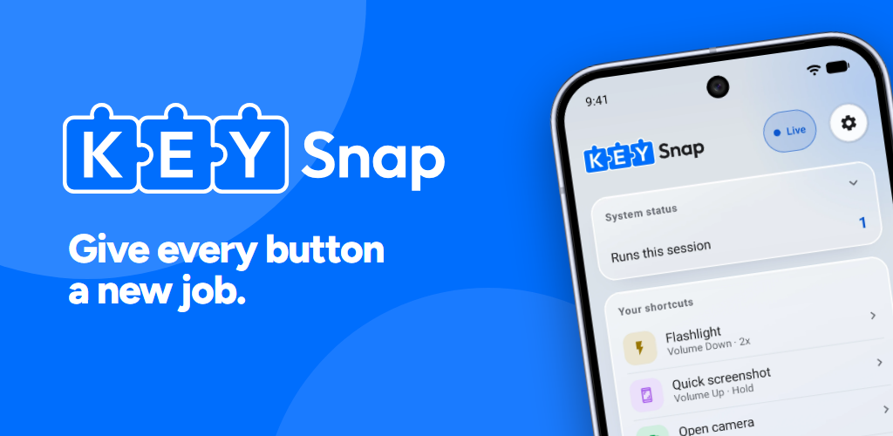
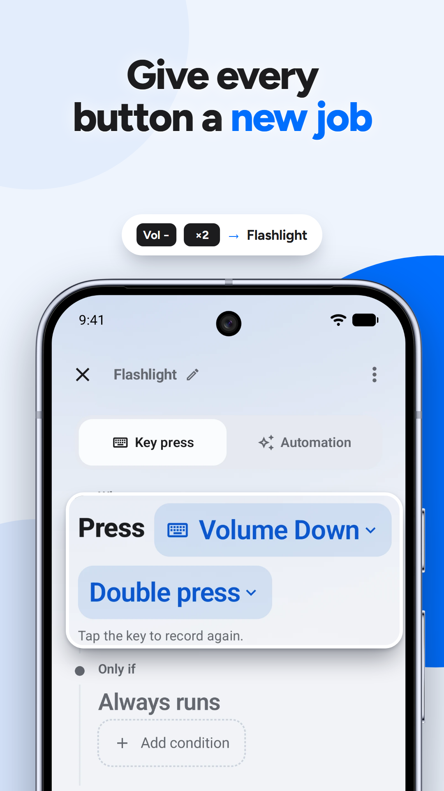
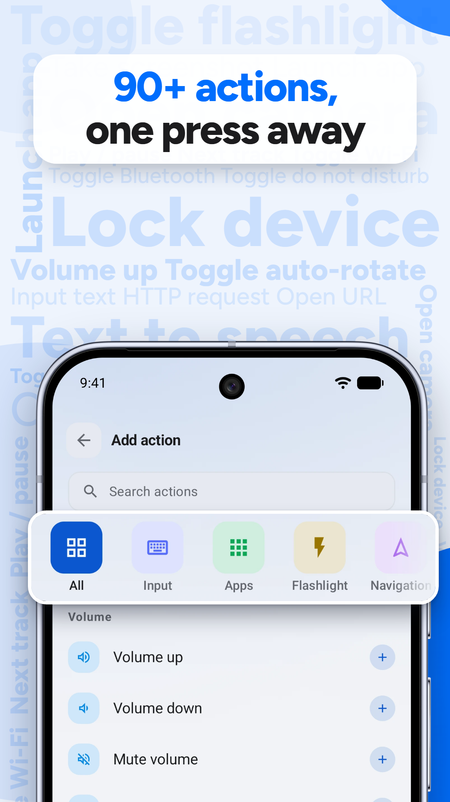
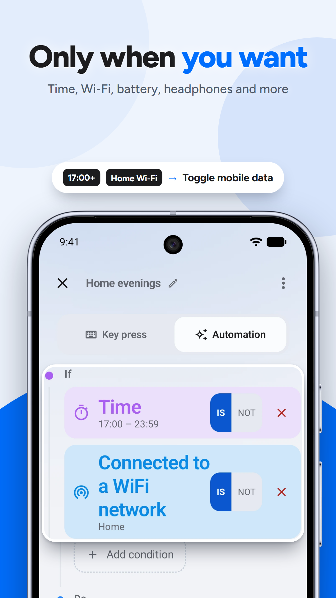
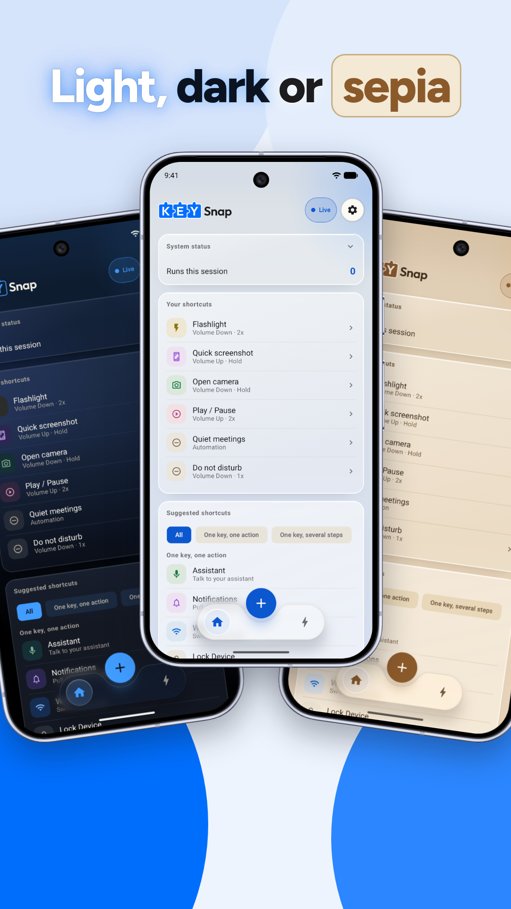
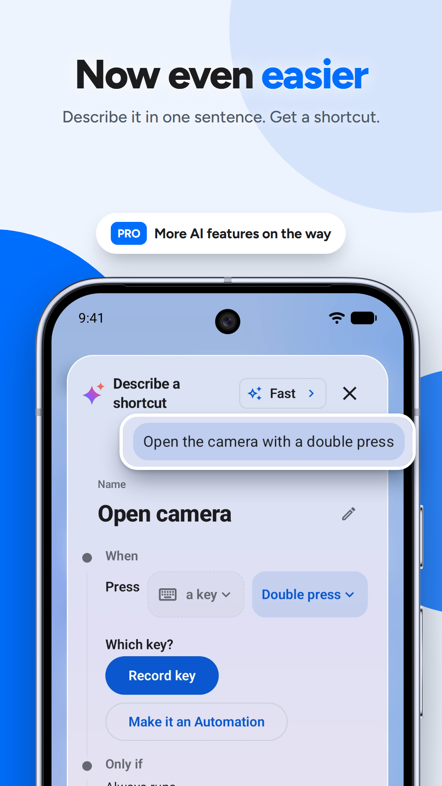
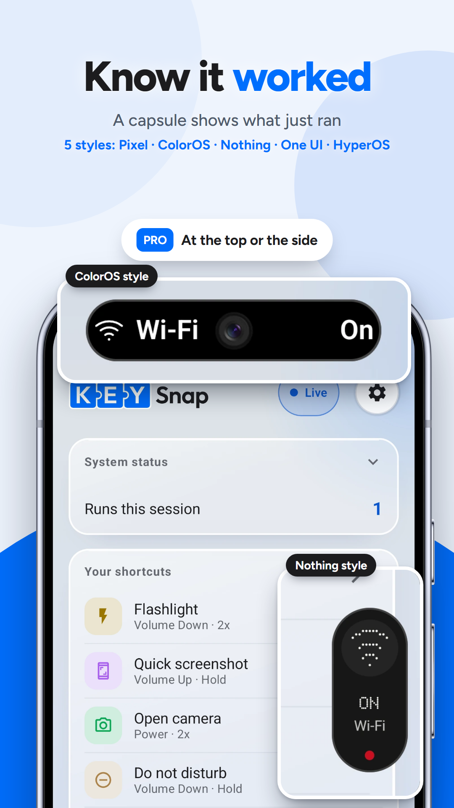
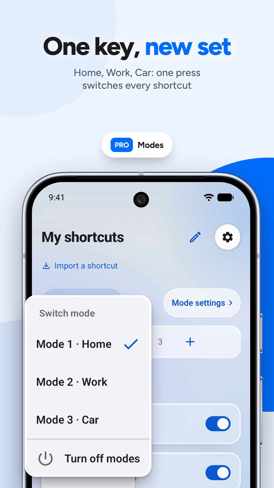

<p align="center">
  
</p>

<h1 align="center">Your buttons. Your shortcuts.</h1>

<p align="center">
  Double-press for the flashlight. Hold for a screenshot. Make a button do more.<br>
  An Android app for button shortcuts and automations, with an open-source core.
</p>

<p align="center">
  <a href="https://play.google.com/store/apps/details?id=io.github.nicholasarda.keysnap"></a>
</p>

<p align="center">
  
</p>

<p align="center">
  <b>Android 11+</b> &nbsp; · &nbsp; <b>No ads</b> &nbsp; · &nbsp; <b>No account</b> &nbsp; · &nbsp; <a href="LICENSE">GPL-3.0 core</a>
</p>

<p align="center">
  <a href="#what-you-can-do">Features</a> &nbsp; · &nbsp;
  <a href="#your-first-shortcut">Get started</a> &nbsp; · &nbsp;
  <a href="docs/guide.md">Full guide</a> &nbsp; · &nbsp;
  <a href="https://github.com/Nicholas-Arda/KeySnap/issues">Report an issue</a>
</p>

---

## A button. A shortcut. Done.

<p align="center">
  
  
  
  
</p>

<p align="center"><b>With Pro</b></p>

<p align="center">
  
  
  
</p>

## What you can do

<table>
  <tr>
    <td width="50%"><h3>🔘 Press your way</h3>Single, double or long press. Combine keys for another shortcut.</td>
    <td width="50%"><h3>⚡ 91 actions</h3>Flashlight, camera, apps, media and more. Chain actions together.</td>
  </tr>
  <tr>
    <td><h3>🕒 Add conditions</h3>Time, Wi-Fi, charging or apps. Automate without pressing a key.</td>
    <td><h3>📌 Widgets & tiles</h3>Run shortcuts or switch them on and off from your home screen and Quick Settings.</td>
  </tr>
  <tr>
    <td><h3>🧩 Pick a recipe</h3>Start with a ready-made shortcut. Customize, share or import.</td>
    <td><h3>🎨 Your look</h3>System, light, dark and sepia. OLED option. Fifteen languages.</td>
  </tr>
  <tr>
    <td><h3>✨ Describe it <sup>Pro</sup></h3>Type one sentence, get a shortcut. The model runs on your phone.</td>
    <td><h3>💊 Know it worked <sup>Pro</sup></h3>A small capsule shows what just ran. Pixel, ColorOS, Nothing, One UI and HyperOS styles.</td>
  </tr>
  <tr>
    <td><h3>🔁 Modes <sup>Pro</sup></h3>Home, Work, Car. One press switches every shortcut.</td>
    <td><h3>🔒 Stays on your phone</h3>No account, no cloud, no analytics. Open-source core.</td>
  </tr>
</table>

### Try this

| Your trigger | Your shortcut |
| :--- | :--- |
| **Double-press Volume Down** | Toggle the flashlight |
| **Hold Volume Up** | Take a screenshot |
| **Double-press Power** | Open the camera with Advanced Mode |
| **A meeting starts** | Turn on Do Not Disturb |

Some shortcuts need an extra permission or Advanced Mode. Key support varies by device.

## Your first shortcut

1. **Install** [KeySnap from Google Play](https://play.google.com/store/apps/details?id=io.github.nicholasarda.keysnap).
2. **Set up** the accessibility service using the in-app guide.
3. **Pick a recipe** or record a button and choose an action.

**Need more keys?** Optional **Advanced Mode** uses your phone's Wireless Debugging to reach additional buttons and run supported actions through an independent helper. [How it works →](docs/guide.md#advanced-mode)

## Good to know

<details>
<summary><b>Free or Pro?</b></summary>

Free includes **three active shortcuts**, every **home-screen widget** and all **three Quick Settings tiles**. Pro removes the shortcut limit with a **one-time purchase** through Google Play. Pro can also build a shortcut from a plain sentence with an on-device model, downloaded once through Google Play when you choose; you review the result before saving. No ads or subscription.

</details>

<details>
<summary><b>Privacy and permissions</b></summary>

No accounts, analytics or automatic crash uploads. Your key presses and shortcuts are not automatically uploaded. Local actions work offline; network actions and RSS feeds contact the destinations you configure. Pro purchases use Google Play Billing. The optional Pro AI model uses Google Play Asset Delivery and runs offline with LiteRT-LM; typed requests never leave your phone. These two SDKs are excluded from the public-source edition.

The accessibility service reads screen content only from Android's Settings app for pairing setup; it cannot read other apps' screens. Other permissions are requested when a feature needs them.

You can also select KeySnap as your digital assistant in Android settings and assign an **Assistant gesture** shortcut in **Set key**. Available gestures, including holding the power button, depend on the phone. The assistant services do not record audio or read screen contents, and add no microphone permission.

[Permission details](docs/guide.md#permissions) · [Privacy policy](https://nicholas-arda.github.io/keysnap-privacy/)

</details>

<details>
<summary><b>Screen off, background use and restarts</b></summary>

Advanced Mode can detect keys with the screen off and run supported actions after the app closes. Actions that need the app or an unlocked screen still have those requirements. Without Advanced Mode, background and screen-off key support depend on Android and your device.

A reboot stops the helper. Optional **Start after restart** brings it back after unlock and Wi-Fi, subject to device restrictions and a valid pairing.

[Setup and troubleshooting →](docs/guide.md#faq)

</details>

<details>
<summary><b>What is not in this repository?</b></summary>

Pro features (AI builder, key capsule and modes) are not part of the public-source edition. Here they compile to no-op stubs, so the public build runs with every free feature.

</details>

<details>
<summary><b>Build from source and contribute</b></summary>

Open the project in Android Studio and use its bundled JDK. To build from the terminal, set `JAVA_HOME` to that JDK:

```bash
git clone https://github.com/Nicholas-Arda/KeySnap.git
cd KeySnap
./gradlew :app:assembleDebug
./gradlew :app:testDebugUnitTest :bridge:test
```

On Windows PowerShell, use `.\gradlew.bat` instead of `./gradlew`. No API key is needed.

[Build instructions](docs/guide.md#building-from-source) · [Contributing and safety rules](docs/guide.md#contributing)

</details>

---

**Need a hand?** [Open an issue](https://github.com/Nicholas-Arda/KeySnap/issues) or email [support@ardasenn.com](mailto:support@ardasenn.com). Include your phone model, Android version and whether Advanced Mode was on.

<p align="center">
  <a href="docs/guide.md">Full guide & FAQ</a> &nbsp; · &nbsp;
  <a href="https://nicholas-arda.github.io/keysnap-privacy/">Privacy policy</a> &nbsp; · &nbsp;
  <a href="LICENSE">GPL-3.0 licence</a>
</p>
