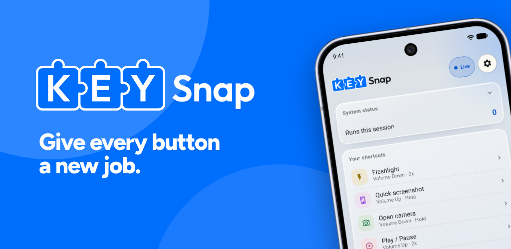
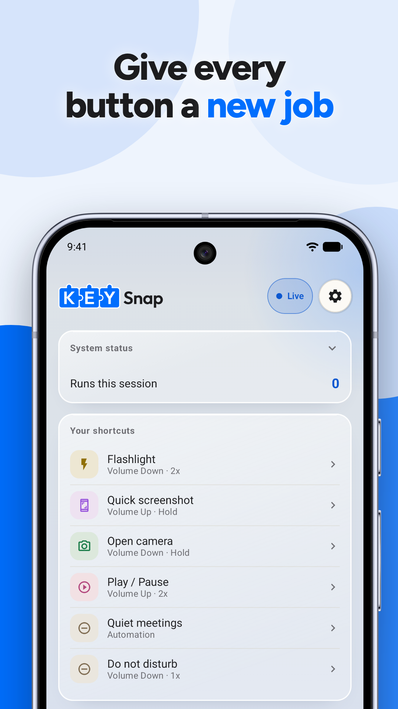
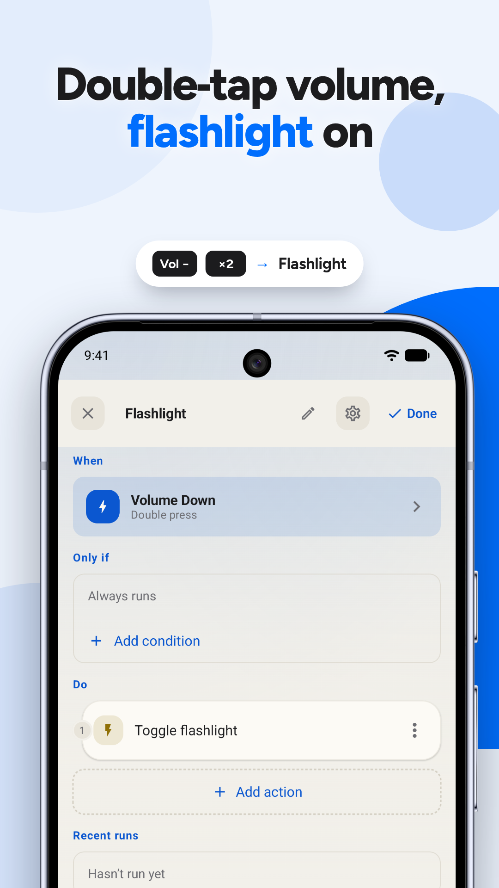
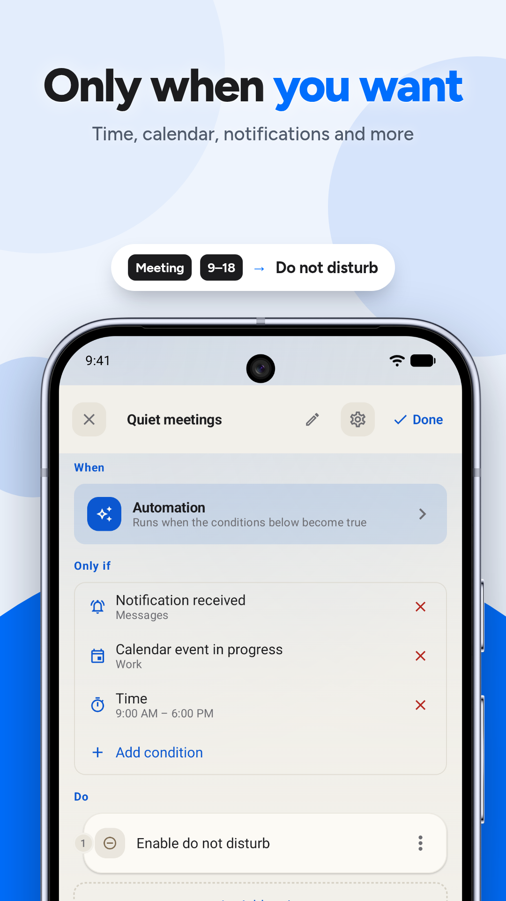
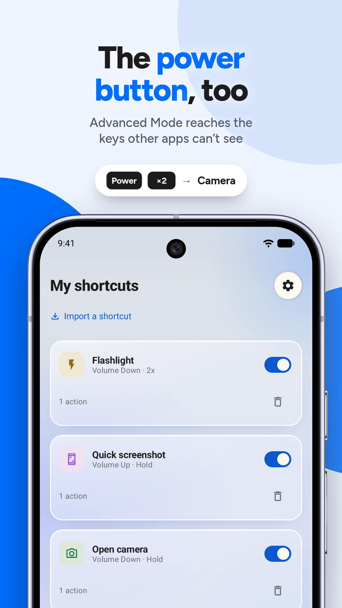
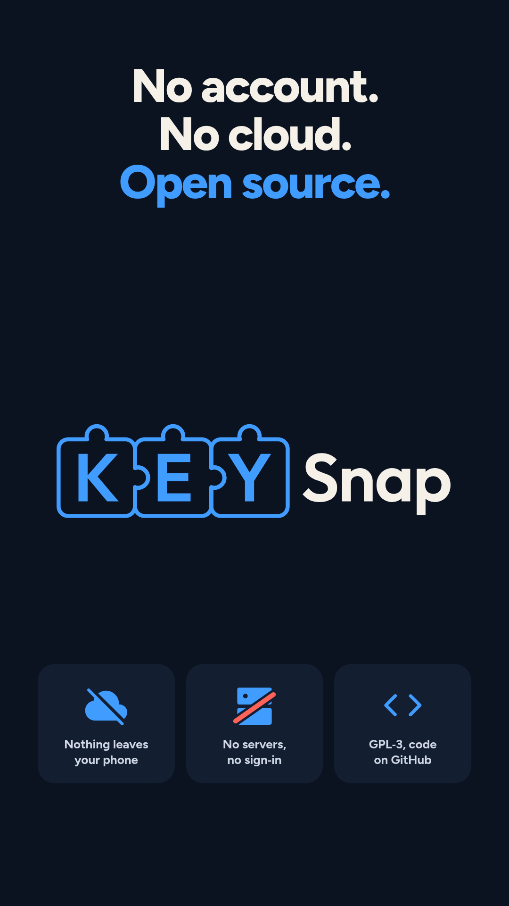
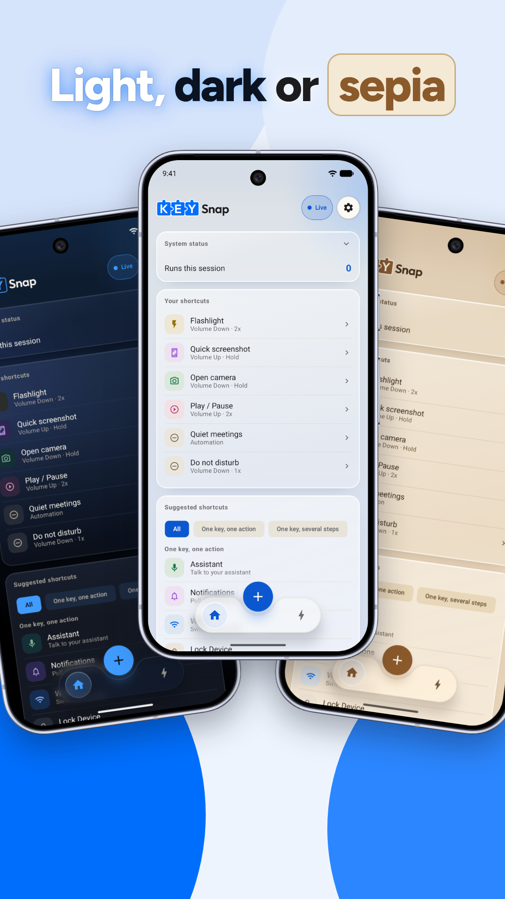

<p align="center">
  
</p>

<h1 align="center">Your buttons. Your shortcuts.</h1>

<p align="center">
  Double-press for the flashlight. Hold for a screenshot. Make a button do more.<br>
  An open-source Android app for button shortcuts and automations.
</p>

<p align="center">
  <a href="https://play.google.com/store/apps/details?id=io.github.nicholasarda.keysnap"></a>
</p>

<p align="center">
  <b>Android 11+</b> &nbsp; · &nbsp; <b>No ads</b> &nbsp; · &nbsp; <b>No account</b> &nbsp; · &nbsp; <a href="LICENSE">GPL-3.0</a>
</p>

<p align="center">
  <a href="#what-you-can-do">Features</a> &nbsp; · &nbsp;
  <a href="#your-first-shortcut">Get started</a> &nbsp; · &nbsp;
  <a href="docs/guide.md">Full guide</a> &nbsp; · &nbsp;
  <a href="https://github.com/Nicholas-Arda/KeySnap/issues">Report an issue</a>
</p>

---

## A button. A shortcut. Done.

<p align="center">
  
  
  
</p>

<details>
<summary><b>See more: Advanced Mode, privacy and themes</b></summary>

<p align="center">
  
  
  
</p>

</details>

## What you can do

<table>
  <tr>
    <td width="50%"><h3>🔘 Press your way</h3>Single, double or long press. Combine keys for another shortcut.</td>
    <td width="50%"><h3>⚡ 90 actions</h3>Flashlight, camera, apps, media and more. Chain actions together.</td>
  </tr>
  <tr>
    <td><h3>🕒 Add conditions</h3>Time, Wi-Fi, charging or apps. Automate without pressing a key.</td>
    <td><h3>📌 Widgets & tiles</h3>Run shortcuts from your home screen or three Quick Settings tiles.</td>
  </tr>
  <tr>
    <td><h3>🧩 Pick a recipe</h3>Start with a ready-made shortcut. Customize, share or import.</td>
    <td><h3>🎨 Your look</h3>System, light, dark and sepia. OLED option. Ten languages.</td>
  </tr>
</table>

### Try this

| Your trigger | Your shortcut |
| :--- | :--- |
| **Double-press Volume Down** | Toggle the flashlight |
| **Hold Volume Up** | Take a screenshot |
| **Double-press Power** | Open the camera with Advanced Mode |
| **A meeting starts** | Turn on Do Not Disturb |

Some shortcuts need an extra permission or Advanced Mode. Key support varies by device.

## Your first shortcut

1. **Install** [KeySnap from Google Play](https://play.google.com/store/apps/details?id=io.github.nicholasarda.keysnap).
2. **Set up** the accessibility service using the in-app guide.
3. **Pick a recipe** or record a button and choose an action.

**Need more keys?** Optional **Advanced Mode** uses your phone's Wireless Debugging to reach additional buttons and run supported actions through an independent helper. No root required. [How it works →](docs/guide.md#advanced-mode)

## Good to know

<details>
<summary><b>Free or Pro?</b></summary>

Free includes **three active shortcuts**, **two home-screen widgets** and all **three Quick Settings tiles**. Pro removes the shortcut and widget limits with a **one-time purchase** through Google Play. No ads or subscription.

</details>

<details>
<summary><b>Privacy and permissions</b></summary>

No accounts, analytics or automatic crash uploads. Your key presses and shortcuts are not automatically uploaded. Local actions work offline; network actions and RSS feeds contact the destinations you configure. Pro purchases use Google Play Billing.

The accessibility service reads screen content only from Android's Settings app for pairing setup; it cannot read other apps' screens. Other permissions are requested when a feature needs them.

[Permission details](docs/guide.md#permissions) · [Privacy policy](https://nicholas-arda.github.io/keysnap-privacy/)

</details>

<details>
<summary><b>Screen off, background use and restarts</b></summary>

Advanced Mode can detect keys with the screen off and run supported actions after the app closes. Actions that need the app or an unlocked screen still have those requirements. Without Advanced Mode, background and screen-off key support depend on Android and your device.

A reboot stops the helper. Optional **Start after restart** brings it back after unlock and Wi-Fi, subject to device restrictions and a valid pairing.

[Setup and troubleshooting →](docs/guide.md#faq)

</details>

<details>
<summary><b>Coming soon: Key capsule</b></summary>

Customizable visual feedback for physical button shortcuts, with different styles, motion and per-key positioning. In development; not included in the current Google Play release.

</details>

<details>
<summary><b>Build from source and contribute</b></summary>

Open the project in Android Studio and use its bundled JDK. To build from the terminal, set `JAVA_HOME` to that JDK:

```bash
git clone https://github.com/Nicholas-Arda/KeySnap.git
cd KeySnap
./gradlew :app:assembleDebug
./gradlew :app:testDebugUnitTest :bridge:test
```

On Windows PowerShell, use `.\gradlew.bat` instead of `./gradlew`. No API key is needed.

[Build instructions](docs/guide.md#building-from-source) · [Contributing and safety rules](docs/guide.md#contributing)

</details>

---

**Need a hand?** [Open an issue](https://github.com/Nicholas-Arda/KeySnap/issues) or email [support@ardasenn.com](mailto:support@ardasenn.com). Include your phone model, Android version and whether Advanced Mode was on.

<p align="center">
  <a href="docs/guide.md">Full guide & FAQ</a> &nbsp; · &nbsp;
  <a href="https://nicholas-arda.github.io/keysnap-privacy/">Privacy policy</a> &nbsp; · &nbsp;
  <a href="LICENSE">GPL-3.0 licence</a>
</p>
